# ELEC 3 - Node.js

**Name:** Mark Neilson Tol
**Section:** IV-BSIT C
**Course:** ELEC 3 - Node.js

## Activities

| Activity | Description | Folder |
|---|---|---|
| N1 | Project setup with npm, package.json, and installed packages | [set1/n1-setup](set1/n1-setup) |
| N2 | Modular calculator using custom modules and process.argv | [set1/n2-calculator](set1/n2-calculator) |
| N3 | File manager using the fs and path modules | [set1/n3-file-manager](set1/n3-file-manager) |
| N4 | Basic HTTP server with routes and a 404 page | [set2/n4-server](set2/n4-server) |
| N5 | REST-style students API (GET, POST, PUT, DELETE) | [set2/n5-api](set2/n5-api) |
| N6 | N5 API extended with logger and JSON middleware | [set2/n6-middleware](set2/n6-middleware) |

## How to run

**N1**

```
cd set1/n1-setup
npm install
npm start
```

**N2**

```
cd set1/n2-calculator
node index.js add 12 8
node index.js divide 5 0
```

Operations: add, subtract, multiply, divide, average

**N3**

```
cd set1/n3-file-manager
node index.js create notes.txt "Hello"
node index.js read notes.txt
node index.js update notes.txt "More text"
node index.js delete notes.txt
node index.js list
```

**N4**

```
cd set2/n4-server
node index.js
```

Open http://localhost:8000, then /about and /contact

**N5**

```
cd set2/n5-api
node index.js
```

Test at http://localhost:3000/api/students

**N6**

```
cd set2/n6-middleware
node index.js
```

Test at http://localhost:3000/api/students

## Screenshots

### N1
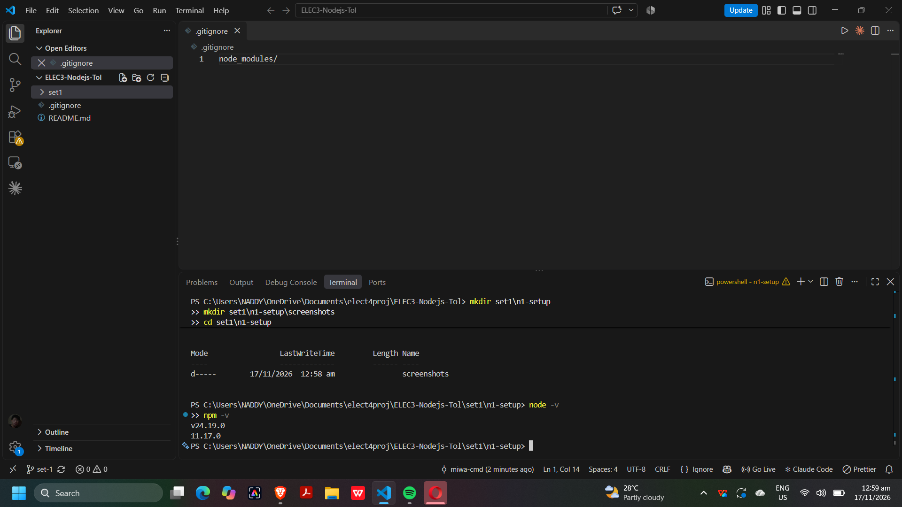
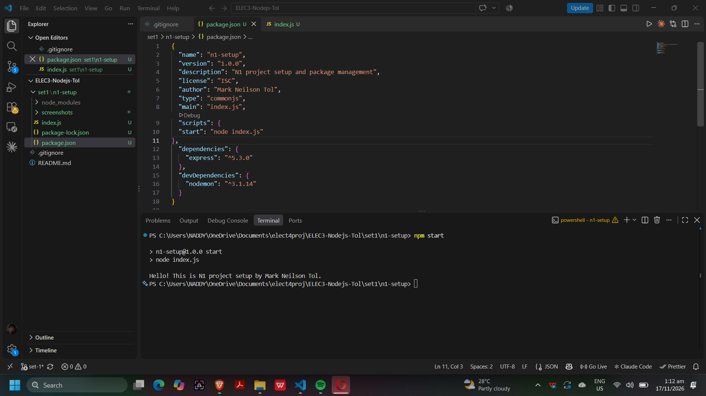


### N2
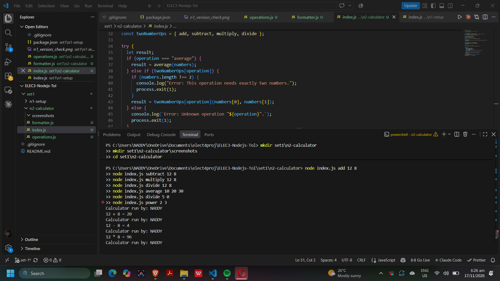
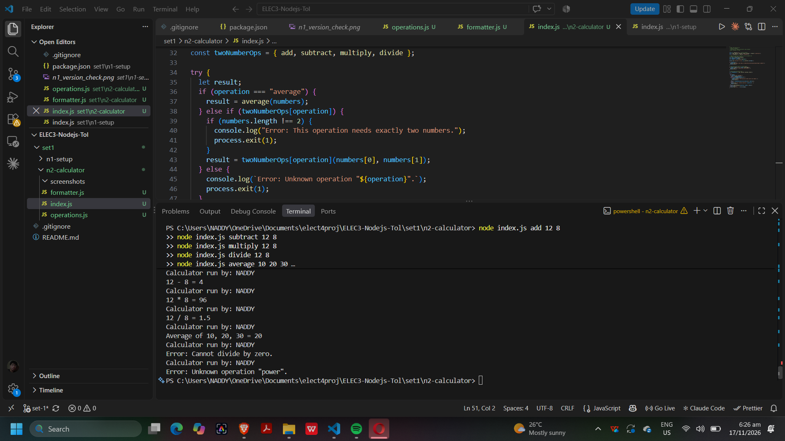

### N3

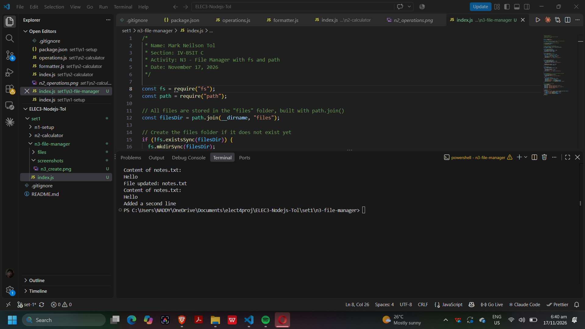


### N4
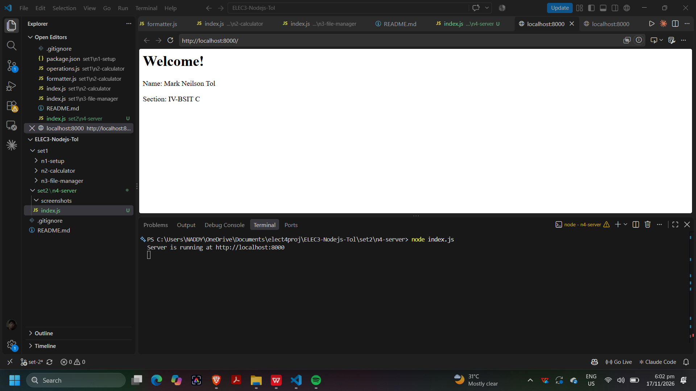
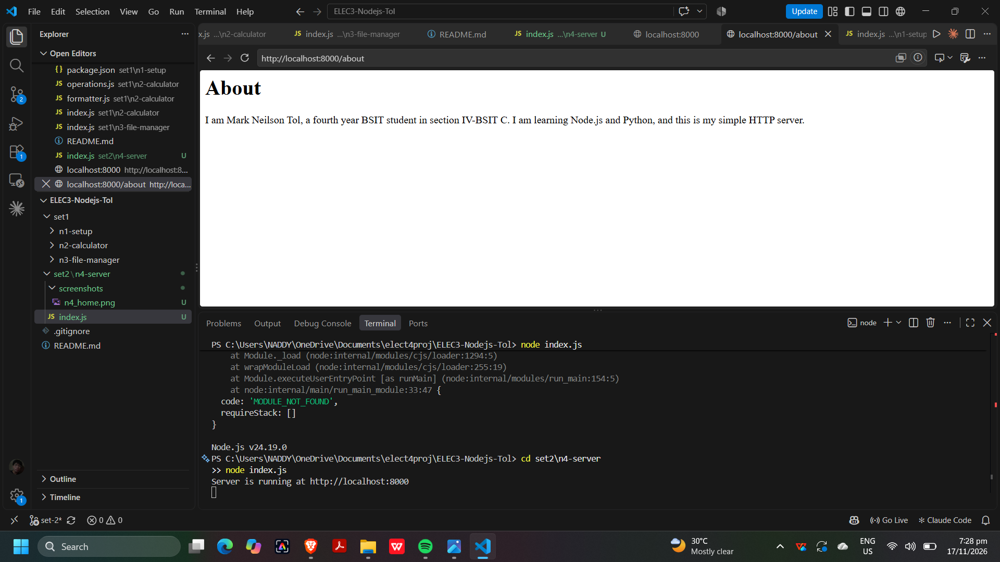

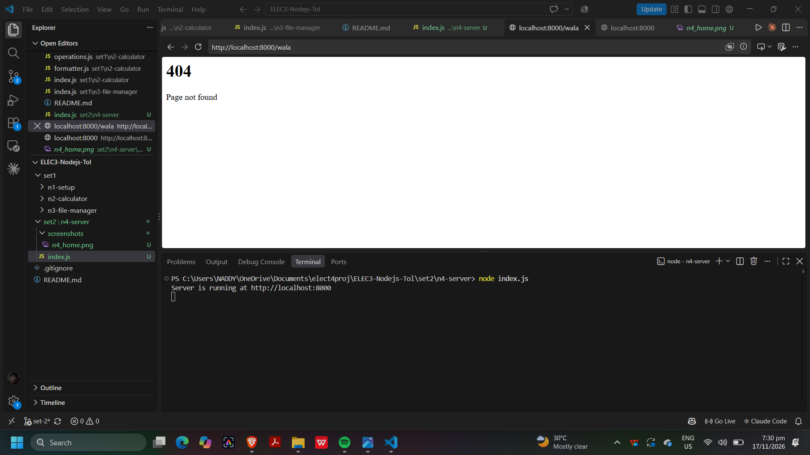

### N5
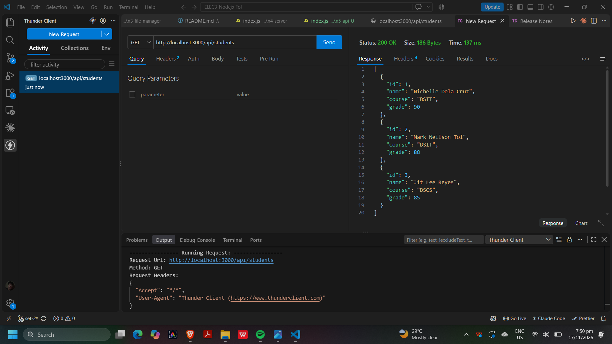

### N6

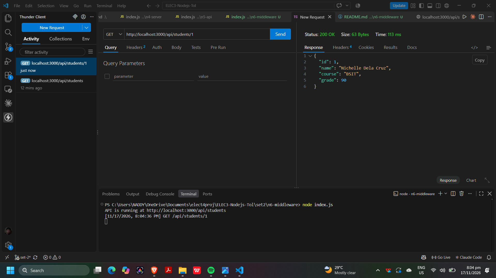
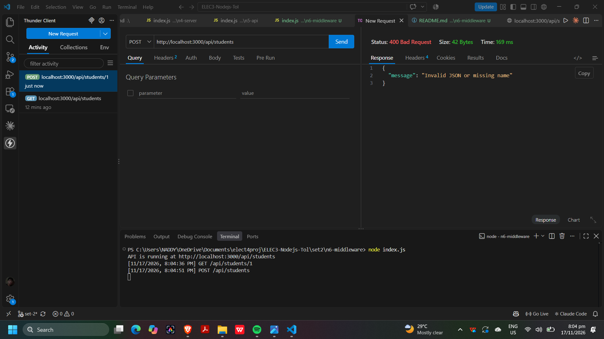
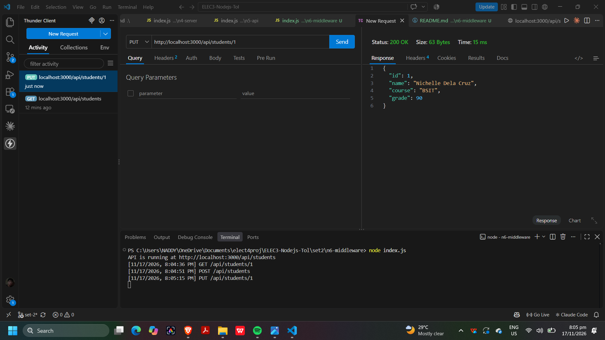
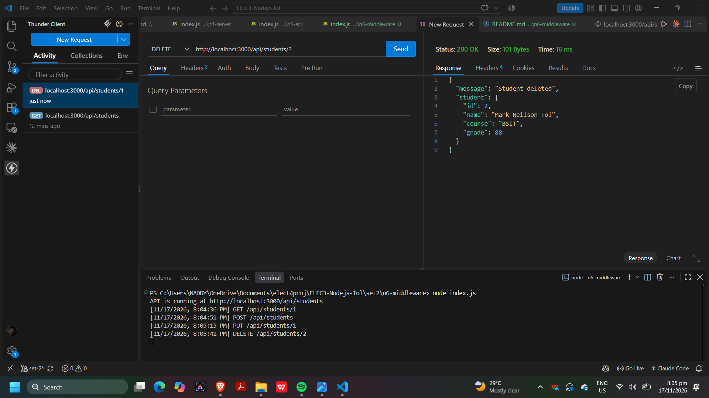
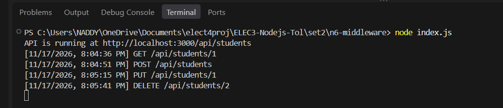